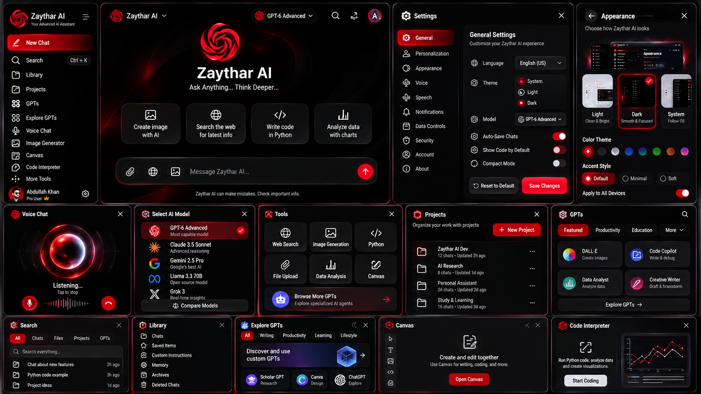
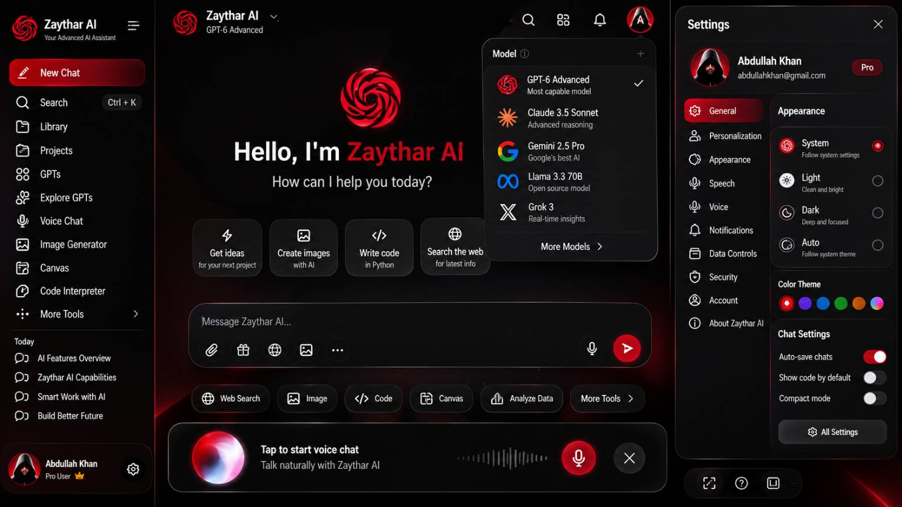

# Zaythar AI — Android Command Nexus

A native Android (Kotlin + Jetpack Compose) command center powered by **Google Sign-In + Cloud Firestore** persistence, **Firebase AI Logic** (`gemini-4-hydrogen`, `gemini-4-carbon`, `gemini-4-neon`, `gemini-4-argon`, `gemini-3.8-flash`, `gemini-3.8-live`, `gemini-3.5-transcribe`, `gemini-3.5-flash-lite`, `gemini-3.1-flash-lite`, and `gemini-nano-banana-2.1`), **Smart Auto-Router**, **Live Internet & Google Maps Grounding**, **Camera Eyes Vision**, **AI Brain**, and an extensible **Plugin Plug Hub**.

## Original UI reference images

The original screenshots are stored in `public/assets/aistudio/` and are used as the visual reference for the existing responsive web workspace and native Android Compose screens. No replacement screenshots or duplicate app implementation are introduced here.

View the original UI references

See [the UI artifact and screen map](design/ui-artifacts/README.md) for the existing web/Android source files, feature boundaries and verification checklist.

## Implemented Features

- **Unified Search Hub & Library Vault (`SearchHubScreen`, `LibraryScreen`)**: Search across Cloud Firestore / local chat threads, saved RAG memories, Knowledge Graph triples, specialist agents, and prompt templates (`search` route), and manage conversation threads, memory notes, and personas in a tabbed Library Vault (`library` route).
- **Obsidian-Crimson Glassmorphic UI, Sidebar & Quick Sheets**: Upgraded 7-blade crimson `ZaytharSpiralEmblem`, interactive `ZaytharHeroWelcomeBanner` quick-action cards, live recent-thread `CyberSidebar` with one-tap **New Chat**, TopBar Search & Tools launchers, `ModelSelectorSheet`, 2x3 `ToolsHubSheet`, Voice Orb visualizer, and segmented `SettingsScreen` with Light/Dark/System visual preview cards and 7 circular color swatches.
- **AI Engine Nexus & Smart Auto-Router**: Dedicated `EngineHubScreen` featuring a deterministic prompt intent classifier (`SmartEngineRouter`) across 9 Zaythar engines, dynamic Gemini tier routing (`AUTO`, `HYBRID`, `FLASH`, `ARGON`, `LITE`, `HYDROGEN`, `CARBON`, `NEON`, `FLASH_LITE_31`), and an **All-Engine Verification Suite** running local deterministic checks + optional live `gemini-3.8-flash` connectivity probes.
- **Voice & Audio Nexus (`gemini-3.8-live` & `gemini-3.5-transcribe`)**:
  - Dedicated `VoiceAndAudioScreen` supporting bidirectional real-time **Gemini Live** voice conversations (`LiveSession.startAudioConversation` with selectable voices, Voice Orb status indicator, interruptions, live captions, and RAG transcript export) and AAC/M4A voice-note recording & transcription (`gemini-3.5-transcribe` with `gemini-3.8-flash` fallback), runtime-gated by `RECORD_AUDIO`.
- **Google Sign-In & Guest Mode**: Authenticated session management via Jetpack `CredentialManager` (`GetSignInWithGoogleOption` & `GetGoogleIdOption`) gating all Cloud Firestore collections per user UID, plus isolated local device **Guest Mode**.
- **Overview & 3D Neural Core Visualizer**: Custom Compose `Canvas` 3D Fibonacci-sphere neural network, `ZaytharSpiralEmblem` & `CyberIconBadge` vector iconography, `VoiceChatBottomBar`, live system telemetry, and a Command Deck launcher.
- **Multi-Session Chat History & AI Assistant**:
  - Persistent multi-thread Cloud Firestore chat sessions (`/users/{userId}/chat_sessions/{sessionId}/messages/{messageId}`) with thread creation, switching, renaming, deletion, quick model switcher (`ModelSelectorSheet`), quick tools sheet (`ToolsHubSheet`), and automatic thread titling.
  - **Visible Thinking Mode (`ThinkingConfig`)**: Native Gemini thought summaries (`includeThoughts = true` with `ThinkingLevel.HIGH`/`MEDIUM`) streamed live and displayed in a collapsible **Zaythar Thinking Process** trace panel, toggleable via `THINK: ON/OFF` or Settings.
  - **Multimodal Chat & Emotional Intelligence (`ZaytharSystemPrompts`)**: Attach photos inline from the chat composer via Android Photo Picker (`PickVisualMedia.ImageOnly`), mirror the user's language (English, Urdu, Roman Urdu/Hinglish, Hindi, etc.), and deliver empathetic, step-by-step problem-solving guidance with resilient fallback model chains.
  - Real-time streaming chat with Android `SpeechRecognizer` voice input (`RECORD_AUDIO`), per-message Markdown-stripped Android `TextToSpeech` spoken replies + one-tap `STOP TTS`, and Gemini 4 / 3.8 / 3.5 / 3.1 model matrix selection.
- **LLM Connect Internet & Google Maps Grounding**:
  - Combines Firebase AI Logic `Tool.googleSearch()` and `Tool.googleMaps()` (including `GoogleMapsGroundingChunk` place citations) with an SSRF-hardened `https://` `WebConnector` and DuckDuckGo / Wikipedia public lookups.
- **AI Brain & Neural Functions**:
  - Dedicated `NeuralBrainScreen` running 4 cognitive modes (**Reasoner**, **Memory Consolidator**, **Strategic Planner**, **Cognitive Diagnostics**) using strict Firebase AI Logic `Schema.obj(...)` structured JSON output and Knowledge Graph triple extraction.
- **Plugin Plug Hub & Deterministic Local Engines**:
  - Cloud-synced extensible capability slots (`/users/{userId}/plugins/{pluginId}`) for `calculator`, `utc_clock`, `unit_converter` (`km/mi`, `m/ft`, `cm/in`, `kg/lb`, `c/f`, `kb/mb/gb/tb`, `ms/s/min/hr`), `json_inspector`, `crypto_hash_uuid` (SHA-256, Base64, UUID v4), `color_text_metrics` (Hex/RGB, word/token stats), and `web_grounding`.
- **Camera Eyes (Multimodal Vision)**:
  - Live photo capture via `ActivityResultContracts.TakePicture` + `FileProvider` and zero-permission Android Photo Picker (`PickVisualMedia.ImageOnly`), 4 vision inspection modes, chat thread sync, and one-tap **Save to RAG Memory**.
- **Image Studio (`gemini-nano-banana-2.1`) & Code Copilot**:
  - Runtime AI text-to-image generation and Photo Picker image-to-image editing (`1:1`, `16:9`, `9:16`) with MediaStore gallery export, paired with Creative Storyboard Briefs.
  - Interactive streaming **Code Copilot** workbench supporting Kotlin, Python, TypeScript, SQL, and Bash.
- **Collaboration Nexus & Hybrid RAG Knowledge Base**:
  - Concurrent Multi-Agent runner executing 1–4 specialists in parallel via Kotlin Coroutines (`async` / `awaitAll`) with Lead Coordinator synthesis, plus Hybrid BM25 + Bigram + Graph RAG retrieval.

## Python Development Support

Python is a first-class language in this repository: the Android Code Copilot offers Python (`.py`) as a selectable target, and the FastAPI companion backend is implemented in Python 3.12.

- Backend project metadata and development tooling are defined in [backend/pyproject.toml](backend/pyproject.toml).
- The supported interpreter version is pinned in `.python-version`.
- Python CI compiles all backend modules before running the pytest suite.
- Install backend development tools with `python -m pip install -e ".[dev]"` from the `backend/` directory.
- Run checks with `python -m compileall -q app tests` and `pytest -v` from `backend/`.

## Architecture

- **UI**: Jetpack Compose + Material 3 (`Navigation Compose`, adaptive sidebar on tablets / drawer + bottom bar on phones, `Space Grotesk` & `Rajdhani` typography).
- **Authentication & Cloud Data**: Firebase Auth (Google Sign-In via `CredentialManager`), Cloud Firestore (`users/{userId}` profiles, `chat_sessions`, `messages`, `plugins`, `brain_runs`, `memories`, and `knowledge_facts` subcollections) backed by zero-trust `firestore.rules`.
- **AI & Security**: `com.google.firebase:firebase-ai` + `FirebaseAppCheck` (`DebugAppCheckProviderFactory` in debug builds, `RecaptchaAppCheckProviderFactory` when `recaptcha_site_key` is configured in release builds).
- **Local Preferences**: Jetpack DataStore Preferences for client-only UI theme, accent, motion, cognitive tuning, Google Search/Maps grounding, and model route settings.

## Local code intelligence (optional developer tooling)

This repository includes an optional [codebase-memory-mcp](https://github.com/DeusData/codebase-memory-mcp) project MCP configuration for local coding agents. It provides a persistent local code knowledge graph, symbol/dependency exploration, and change-impact context. It is developer-workstation tooling, not an Android runtime dependency. See [docs/CODEBASE_MEMORY_MCP.md](docs/CODEBASE_MEMORY_MCP.md) for installation, setup, security, and limitations. Local `.codebase-memory/` index data is Git-ignored. For bounded snippet-level Python/Kotlin/Gradle dependency inspection through the backend agent API, see [Static Codebase Analysis Agent](docs/CODEBASE_ANALYSIS_AGENT.md).
