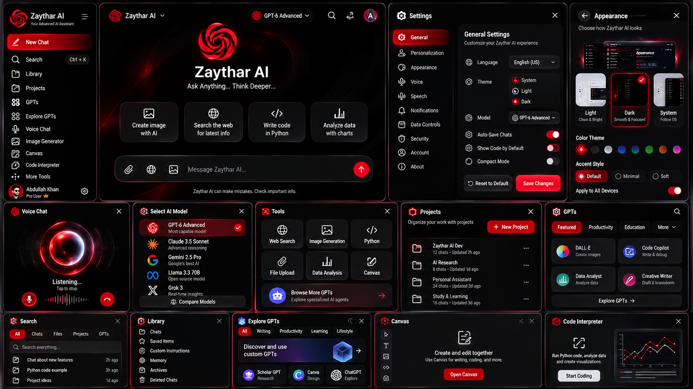
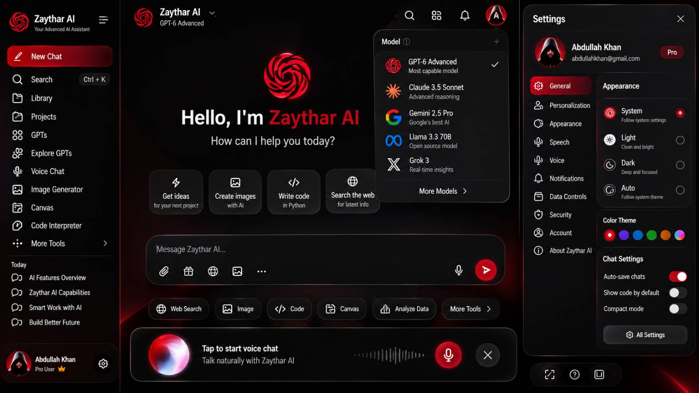

# Zaythar AI UI artifact package

**Purpose:** canonical entry point for the supplied desktop/mobile UI references, implementation map, feature inventory and verification checklist.

## Original reference screenshots

These are the two original UI reference assets already supplied to this repository. They are linked directly from their existing files — no recreated, substituted or duplicate images.

- **Reference A:** [Open original image](../../public/assets/aistudio/file_000000001ce8821197b271341d7b38e6_dc6e9588.png)

  

- **Reference B:** [Open original image](../../public/assets/aistudio/file_00000000f718821188e48dc2073c5ccf_57cc39c1.jpg)

  

## Included artifacts
- `UI_ARTIFACTS_OVERVIEW.md` — detailed screen-by-screen and feature-by-feature guide.
- `../REFERENCE_UI_SPEC.md` — visual design specification and integration boundaries.
- `../../website/app.html`, `app.css`, `app.js` — original responsive web workspace implementation.
- Android Compose screens under `../../app/src/main/java/com/example/ui/` — native mobile implementation.

## Feature inventory

| Feature | Intended UI | Implementation location | Verification note |
|---|---|---|---|
| Main chat | Greeting, conversation, composer | Web `website/app.js`; Android `AssistantScreen.kt` | Test send/receive against configured backend |
| Navigation | Sidebar/drawer and recent chats | Web `app.html` / `app.js`; Android navigation screens | Test all routes and mobile drawer |
| Provider selector | Configured model list | Web `app.js`; backend model catalog | Show only configured routes |
| Settings | General, appearance, account and controls | Android `SettingsScreen.kt`; web settings view | Verify persistence and actual effect |
| Themes/accent | Dark/light/system and accent | Android `Theme.kt`; web CSS variables | Check contrast and persistence |
| Voice | Speech input and transcript | Web `app.js`; Android voice screens | Requires permissions and supported speech service |
| Image Studio | Image prompt and generation | Android image screens; web status panel | Requires configured image backend |
| Web research | Search/research entry | Tool surfaces | Backend endpoint/provider must be configured |
| Code | Code draft/review | Android CodeCopilot; web code view | Code review is not code execution |
| Canvas | Editable writing surface | Web `app.js`; Android Canvas screens | Browser draft is local unless sync is added |
| Projects | Project organization | Web `app.js`; Android project screens | Confirm persistence/sync scope |
| GPTs/personas | Persona selection | Web `app.js`; Android agent/persona screens | Marketplace requires a connected service |
| Search / Library | Find chats and saved material | Web `app.js`; Android search/library screens | Verify local vs cloud storage semantics |

## Design principles
- Graphite/black base, crimson Zaythar accent, silver borders, white text.
- Consistent rounded cards, restrained glow, strong selected/focus states.
- Responsive desktop sidebar and mobile drawer/single-column layout.
- Accessible labels, touch targets and contrast in both light and dark themes.
- Do not add decorative controls that imply a capability that is not implemented.

## Source of truth
The original source code in the paths above is the implementation source of truth. This package intentionally avoids copied duplicate UI files. Update the original files when implementing changes.

## Completion status
This package documents and maps the requested UI. It does **not** certify that every feature is fully integrated or that the Android CI/APK build passes. Use GitHub Actions and device/browser tests for that evidence.
